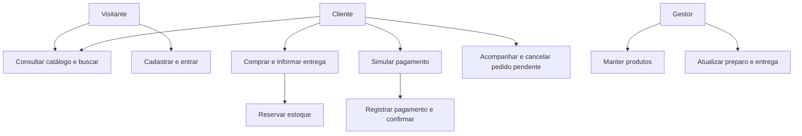
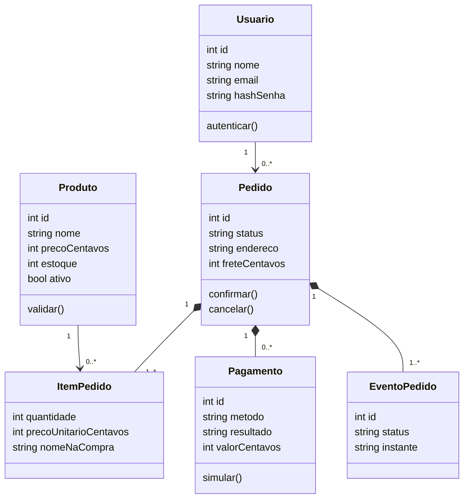
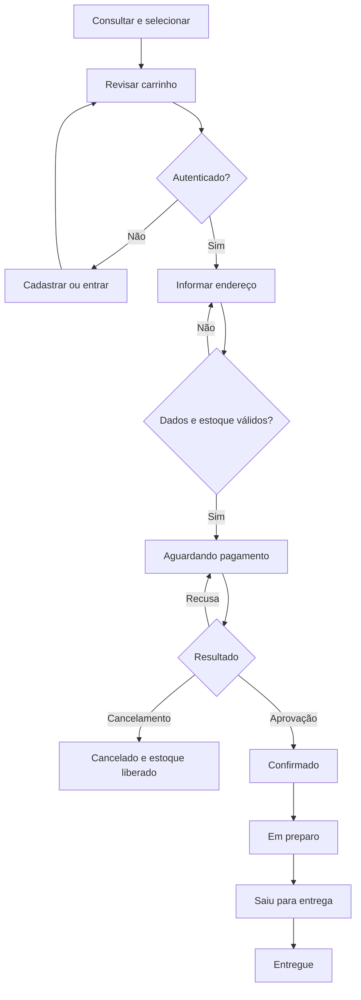

# Modelagem UML

## Caso de uso geral

Atores: Visitante (consultar, buscar, detalhes, cadastrar e entrar), Cliente autenticado (carrinho, checkout, pagar, cancelar, acompanhar e sair), Gestor (autenticar, manter produtos, consultar pedidos e avançar entrega). O cliente utiliza todas as consultas públicas. Não há ator de banco real: o pagamento é simulado localmente.



O mapa acima resume as interações. Na notação de casos de uso, as ações correspondem às elipses dentro da fronteira Doce Órbita; os três atores estão fora dessa fronteira. O diagrama vetorial `casos-de-uso.svg` fornece essa representação.

## Casos de uso expandidos

### UC01 Cadastrar e autenticar

Ator: visitante. Pré-condição: sem conta ou sessão ativa. Pós-condição: cliente autenticado ou erro sem criação parcial. Fluxo: (1) abrir cadastro; (2) preencher nome, e-mail, senha e confirmação; (3) validar limites e unicidade; (4) persistir hash; (5) abrir sessão; (6) entrar no catálogo. Alternativas: e-mail repetido orienta entrar; confirmação divergente ou senha curta mantém formulário sem senha. Login de conta existente verifica hash; falha retorna mensagem genérica. Sair limpa sessão. Regras HU01–03.

### UC02 Consultar e selecionar

Ator: visitante/cliente. Pré-condição: catálogo disponível. Pós-condição: produtos consultados ou carrinho alterado. Fluxo: (1) ver lista; (2) pesquisar nome/sabor; (3) abrir detalhes; (4) consultar preço, alergênicos e estoque; (5) escolher quantidade; (6) adicionar. Alternativas: sem resultado oferece limpar; inativo/inexistente retorna 404; quantidade acima do estoque gera erro; quantidade 0 na revisão remove. Regras HU04–08.

### UC03 Confirmar pedido

Ator: cliente. Pré-condição: autenticado, carrinho não vazio. Pós-condição: pedido pendente e estoque reservado atomicamente. Fluxo: (1) revisar itens e frete; (2) informar endereço; (3) conferir total; (4) confirmar; (5) validar endereço, produtos e quantidades no servidor; (6) iniciar transação imediata; (7) revalidar estoque; (8) gravar pedido e itens com preços da compra; (9) reduzir estoque; (10) registrar evento e concluir; (11) abrir pagamento. Alternativas: sem sessão vai ao login; endereço inválido mantém campos; estoque insuficiente aborta integralmente; mesma chave retorna mesmo pedido sem descontar outra vez. Regras HU09–10.

### UC04 Simular pagamento

Ator: proprietário do pedido. Pré-condição: aguardando pagamento. Pós-condição: tentativa registrada e, se aprovada, pedido confirmado. Fluxo: (1) escolher Pix/cartão demonstrativo; (2) escolher aprovação/recusa; (3) enviar; (4) validar posse e estado em transação; (5) registrar tentativa e valor; (6) se aprovado, confirmar e registrar evento; (7) exibir histórico. Alternativas: recusa mantém pendente; repetição após aprovação recusada; outro cliente recebe 404; não são solicitados dados bancários. Regra HU11.

### UC05 Cancelar

Ator: proprietário. Pré-condição: pendente. Pós-condição: cancelado e estoque restaurado uma vez. Fluxo: (1) solicitar cancelamento; (2) confirmar na página; (3) bloquear escrita e verificar estado; (4) restaurar quantidades; (5) alterar estado e registrar evento. Alternativas: Manter pedido ou Escape desfaz confirmação sem POST; após aprovação cancelar não é permitido; repetição é recusada. Regra HU12.

### UC06 Acompanhar e entregar

Atores: cliente e gestor. Pré-condição: cliente possui pedido; gestor possui sessão própria. Pós-condição: histórico consultado/atualizado. Fluxo cliente: (1) abrir Meus pedidos; (2) selecionar pedido; (3) ver eventos, itens, endereço e tentativas. Fluxo gestor: (1) autenticar gestão; (2) abrir pedido pago; (3) avançar para preparo; (4) saída; (5) entregue. Alternativas: não pode pular estado ou avançar sem pagamento; formulário desatualizado exige atualização; usuário não autorizado não acessa gestão. Regras HU13 e 15.

### UC07 Manter catálogo

Ator: gestor. Pré-condição: sessão de gestão. Pós-condição: produto criado/editado/inativado. Fluxo: (1) abrir produtos; (2) selecionar novo/editar; (3) preencher atributos e disponibilidade; (4) validar; (5) salvar. Alternativas: preço/estoque inválido ou nome repetido gera erro; produto não é apagado para preservar referências de pedidos. Regras HU14.

## Classes de persistência



As classes representam entidades do domínio. Na implementação funcional Python, as operações estão no módulo models.py e os registros são linhas SQLite; não se afirma ORM ou classes Python inexistentes. ItemPedido e eventos pertencem ao ciclo de vida lógico do pedido; as tabelas físicas impedem exclusão de referências. Produto e Usuário têm existência independente.

## Sequência de compra

```mermaid
sequenceDiagram
 actor C as Cliente
 participant V as Tela
 participant H as Controlador
 participant M as Modelo
 participant D as SQLite
 C->>V: Confirmar endereço e pedido
 V->>H: POST /finalizar + CSRF + chave
 H->>M: checkout(cliente, carrinho, endereço, chave)
 M->>D: BEGIN IMMEDIATE; consultar chave e estoque
 alt Estoque e dados válidos
 M->>D: INSERT pedido e itens; UPDATE estoque; INSERT evento
 M->>D: COMMIT
 M-->>H: número do pedido
 H-->>V: redirect para pagamento
 else Falha de validação
 M->>D: ROLLBACK
 M-->>H: mensagem
 H-->>V: formulário com dados preservados
 end
```

## Sequência de pagamento

```mermaid
sequenceDiagram
 actor C as Cliente
 participant H as Controlador
 participant M as Modelo
 participant D as SQLite
 C->>H: POST pagamento simulado
 H->>M: pay(id, cliente, método, resultado)
 M->>D: transação; conferir proprietário e estado
 alt Aprovado
 M->>D: gravar pagamento; confirmar pedido; evento
 else Recusado
 M->>D: gravar tentativa recusada
 end
 M->>D: COMMIT
 H-->>C: histórico atualizado
```

## Atividades e estados


